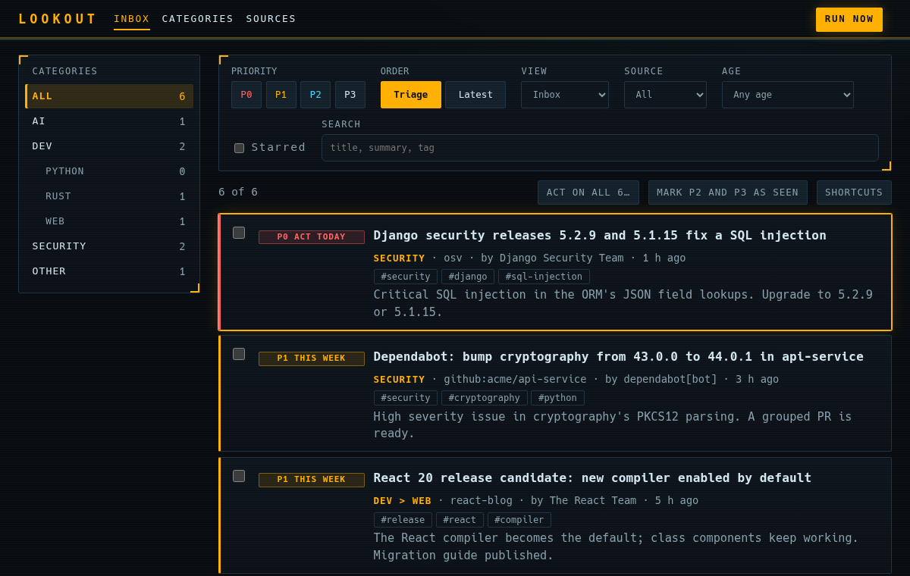
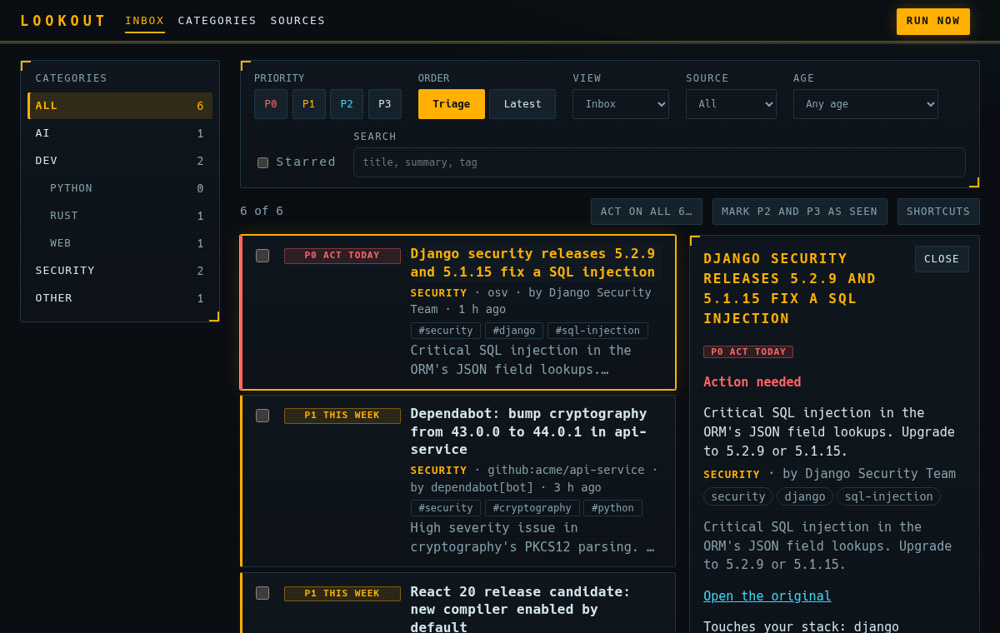
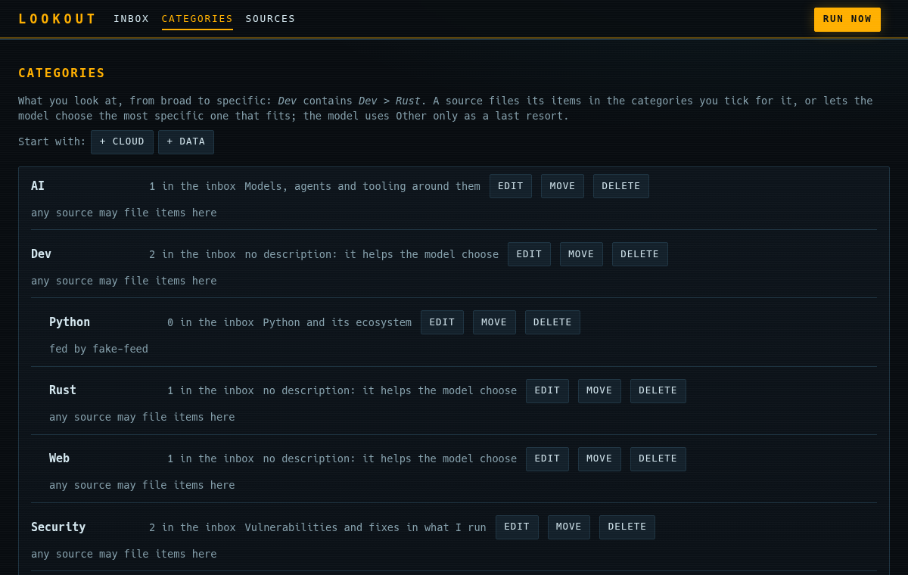

# Design proposal: Mech cockpit

A heads-up display. Near-black glass, **amber** for what needs you, **cyan** for what is only information, monospace
everywhere, square corners with bracket marks, a coloured **threat stripe** on each row (red P0, amber P1, cyan P2), and the
focused item lit like a locked target. Dark only.

|          | Value                                                         |
| -------- | ------------------------------------------------------------- |
| Surface  | `#080c10` background, `#0d141b` panels                        |
| Text     | `#d3e6ee` (15:1), muted `#86a1ad`                             |
| Accent   | amber `#ffb000`, cyan `#3fd8ff` for focus and P2              |
| Type     | the system monospace stack (no font to download)              |
| Contrast | every text and badge pair is above 4.5:1 (checked), axe clean |

It is one CSS layer, `frontend/src/theme.css`, imported after `styles.css` in `main.tsx`. Delete the import to go back.
Nothing else changes: no markup, no behaviour.

