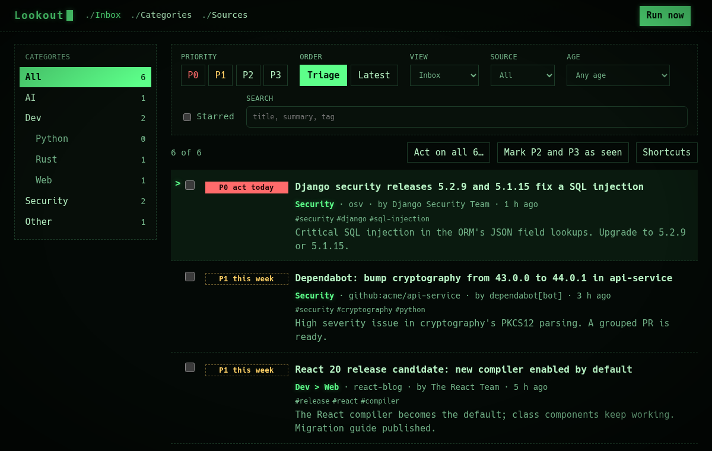
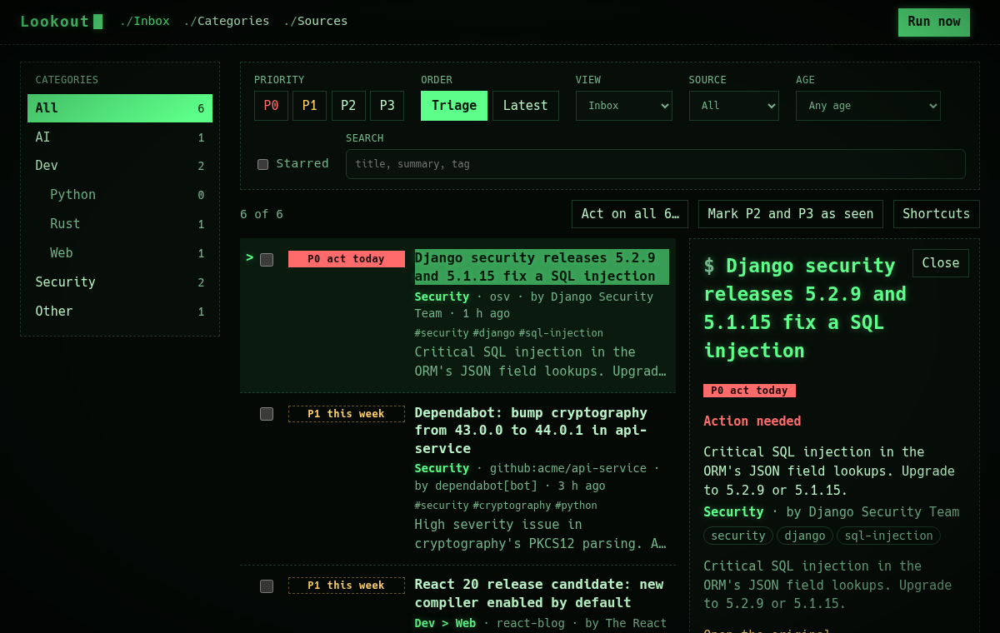
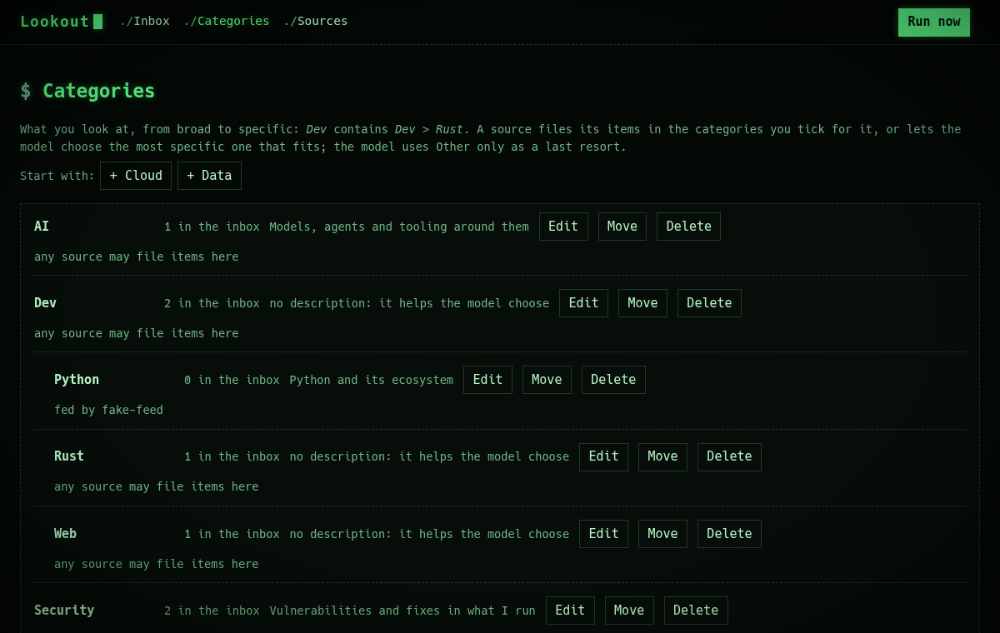

# Design proposal: Phosphor terminal

A green CRT. Black glass, **one phosphor green**, monospace, dashed lines instead of boxes, a block cursor after the name, a
`>` marking the focused row, `./` before the pages, text that glows a little, and a vignette so the corners fall off like a
tube. Dark only.

|          | Value                                                         |
| -------- | ------------------------------------------------------------- |
| Surface  | `#040906` background, `#08110b` panels                        |
| Text     | `#b9f5c6` (16:1), muted `#74b58a`                             |
| Accent   | phosphor `#5dff8a`; P0 `#ff6b6b`, P1 `#ffd166`                |
| Type     | the system monospace stack (no font to download)              |
| Contrast | every text and badge pair is above 4.5:1 (checked), axe clean |

It is one CSS layer, `frontend/src/theme.css`, imported after `styles.css` in `main.tsx`. Delete the import to go back.
Nothing else changes: no markup, no behaviour. The `./`, `$` and `>` marks are drawn with CSS, so some screen readers may
read them; if this one is chosen they would be hidden from them.

