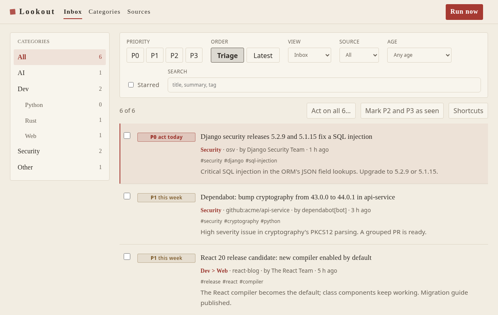
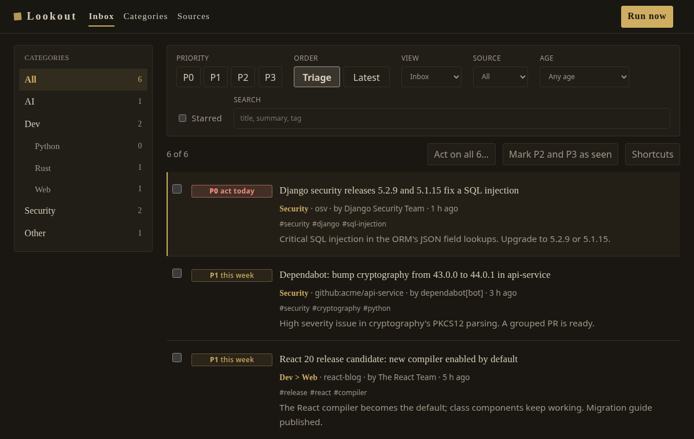
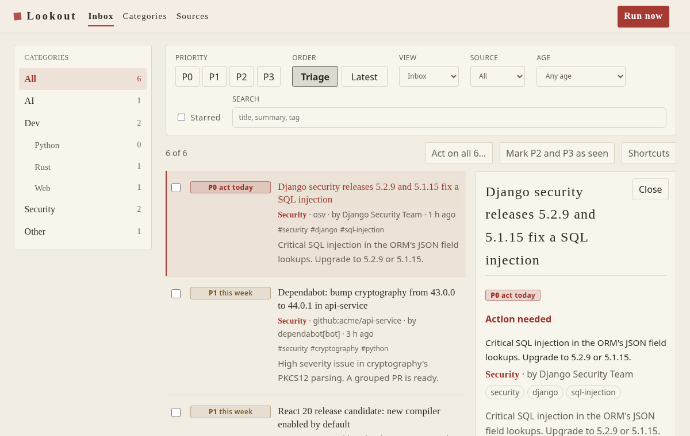
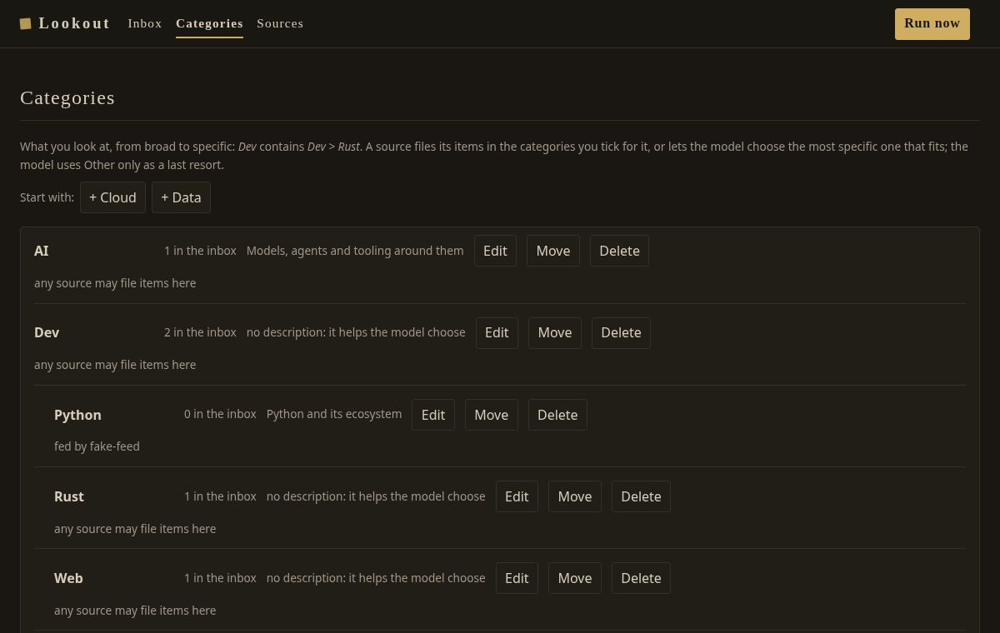

# Design proposal: Samurai calm

The Samurai ink idea, made easier on the eyes. Same paper, ink and seal, with less glare and less weight.

| Softer than Samurai ink                                         | How                                                            |
| --------------------------------------------------------------- | -------------------------------------------------------------- |
| Text contrast about 12:1 instead of 15:1 (still well above AA)  | `#2e2a25` on warm paper `#f2ede2`; dark `#d6cdbc` on `#1a1712` |
| No dotted paper texture                                         | a plain background                                             |
| One-pixel rules, no heavy ink line above panels, no double rule | hairlines in `#ddd5c5` / `#353026`                             |
| P0 is a tinted seal, not a solid block                          | 15% tint of the red with a 55% outline                         |
| Lighter titles                                                  | serif at weight 500 instead of 600                             |
| More air                                                        | line height 1.65, taller rows                                  |
| Dark is a brown-black lacquer, not pure black                   | `#1a1712`, muted gold `#cfae62`, a softer red `#ef8a80`        |
| Selected states are tints, not inversions                       | the active category and priority chips                         |

Every text and badge pair is above 4.5:1 (checked numerically), and the accessibility scans pass in light and dark.

It is one CSS layer, `frontend/src/theme.css`, imported after `styles.css` in `main.tsx`. Delete the import to go back.
Nothing else changes: no markup, no behaviour.

