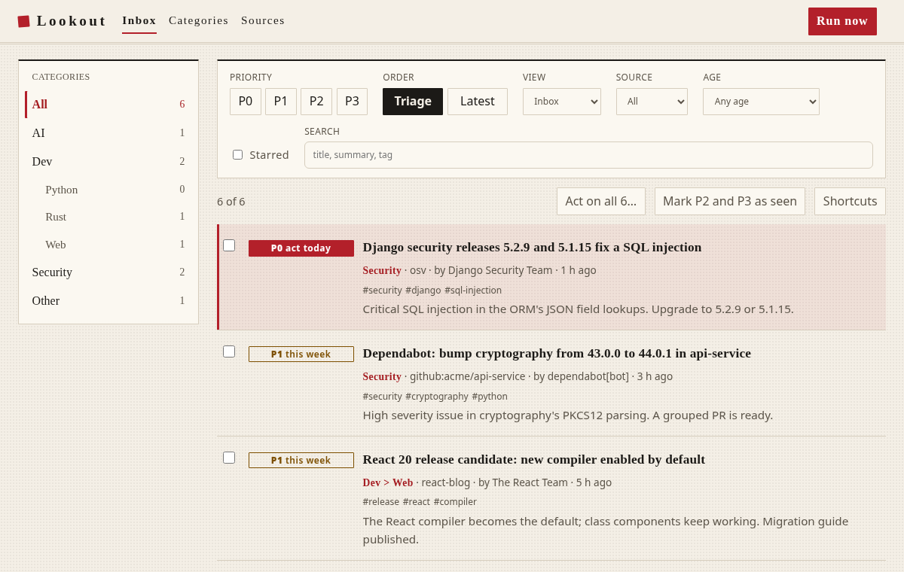
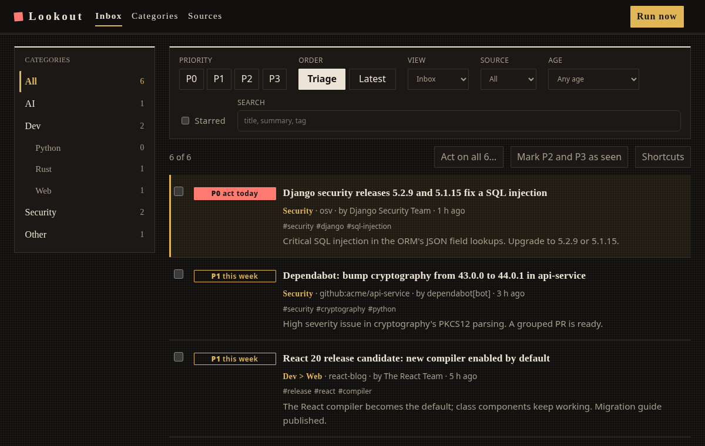
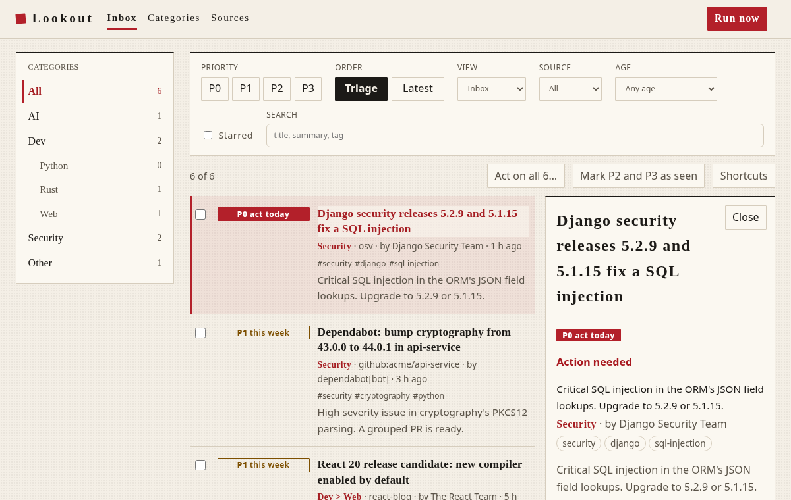
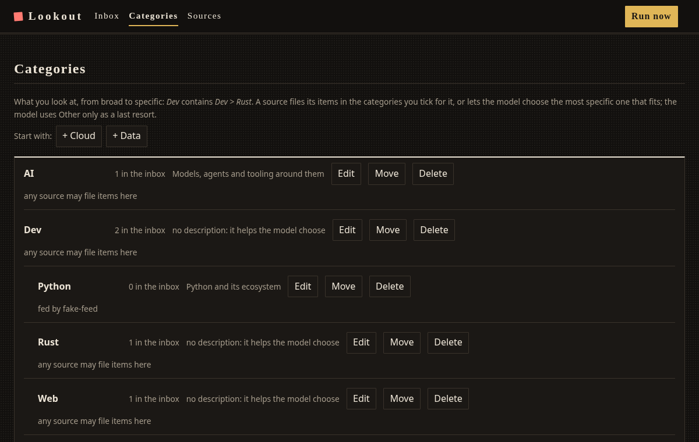

# Design proposal: Samurai ink

Washi paper and sumi ink. One **vermilion seal** for what is urgent (the P0 badge, the active category, the mark before the
name), serif headings, hairline rules instead of boxes, a list that reads like a column of printed entries. Quiet rather
than lit. **Light is paper; dark is black lacquer with gold.**

|          | Light                                                                                                             | Dark                                |
| -------- | ----------------------------------------------------------------------------------------------------------------- | ----------------------------------- |
| Surface  | `#f4efe6` paper, `#fbf8f1` panels                                                                                 | `#12100e` lacquer, `#1b1815` panels |
| Text     | `#1c1a17` (15:1), muted `#5b5449`                                                                                 | `#ece4d6` (15:1), muted `#a89e8e`   |
| Accent   | vermilion `#b3202a`                                                                                               | gold `#e0b657`, seal `#ff7b72`      |
| Type     | headings in the system serif stack (Hiragino Mincho, Yu Mincho, Noto Serif JP, Palatino, Georgia); body unchanged |
| Contrast | every text and badge pair is above 4.5:1 (checked), axe clean in both                                             |

It is one CSS layer, `frontend/src/theme.css`, imported after `styles.css` in `main.tsx`. Delete the import to go back.
Nothing else changes: no markup, no behaviour.

